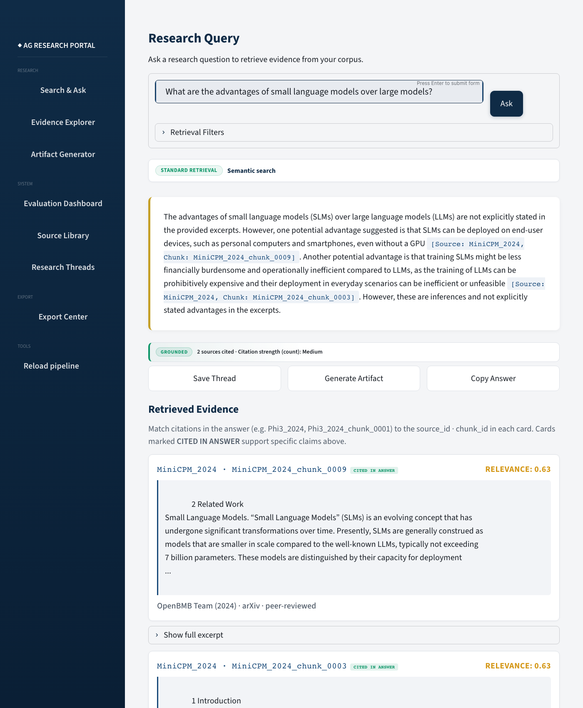
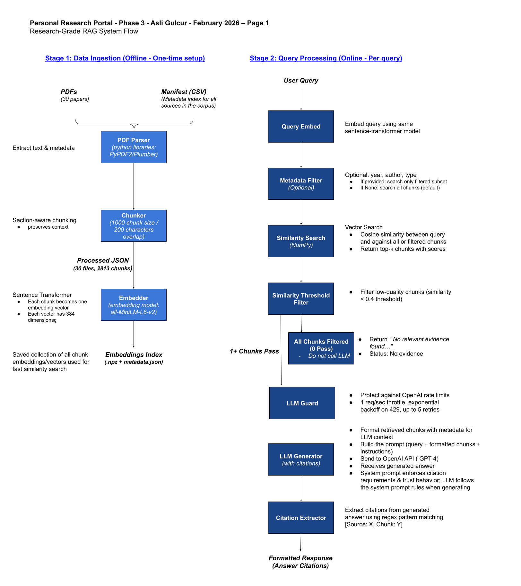
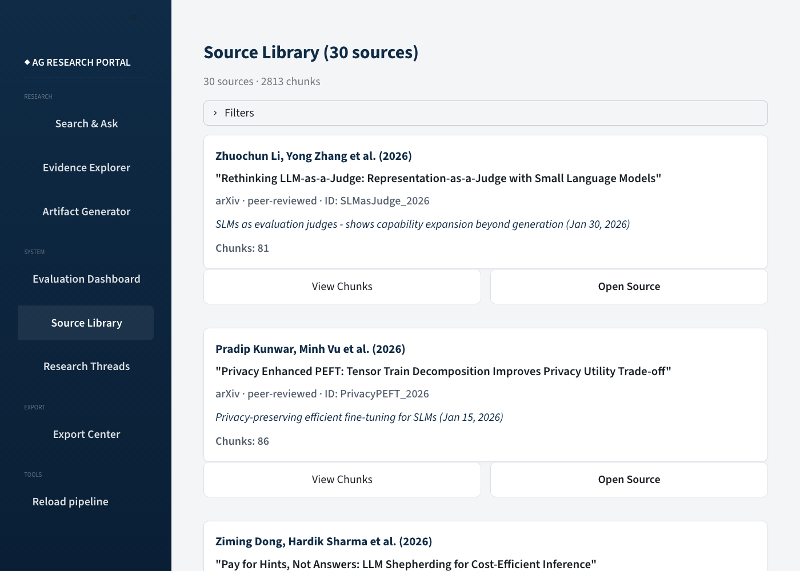
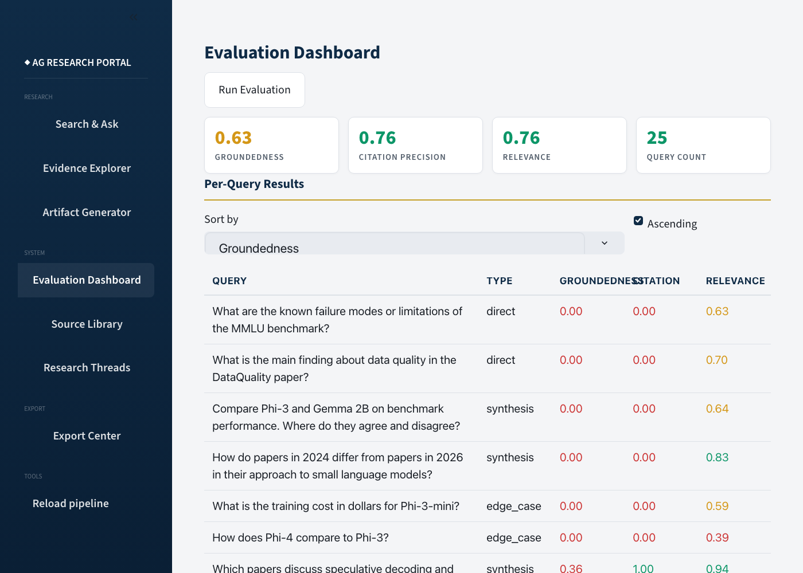

# RAG Research Portal — Small Language Models

A retrieval-augmented generation (RAG) system that answers questions about 30 research papers, mostly on small language models (SLMs). Design goal: **every citation must point to a real paper in the corpus.** The model is told to cite the passage behind each claim, code checks every citation before it's shown, and a 25-question evaluation measures the result.

*Built solo for CMU Heinz College's AI Model Development (February 2026), with AI coding assistance.*

**Result:** in the three final GPT-4 evaluation runs, all 171 citations pointed to a real paper and to a passage the system retrieved for that question. Four earlier development runs show why the code check is there: 27 citations named sources that don't exist in the corpus (such as `[Source: All excerpts]`), and the app's validator strips citations like these before they're shown. Next step: a faithfulness check, testing whether each cited passage actually supports its sentence.

**[▶ Watch the 11-minute demo](https://drive.google.com/file/d/1dGwFooVE9zMVlAFHEoVknEUmUEWyPqC6/view)** (recorded February 22, 2026). To skip ahead: **0:50** a question answered with citations · **8:55** scores on the 25-question evaluation · **9:55** questions it refused rather than risk an unsupported answer.

## Why this exists

Most RAG demos optimize for fluent answers. In a research or enterprise setting, a fluent answer with an invented citation is worse than no answer, because it makes a hallucination look verifiable. This project treats *trust* as a testable property:

- Every factual claim must carry a citation in the form `[Source: paper_id, Chunk: chunk_id]`.
- In the app, each citation's source is checked against the actual corpus. Citations naming a source that doesn't exist are stripped from the answer and surfaced as a red warning — the model is not trusted to police itself.
- When retrieved evidence is weak or absent, the system is designed to refuse rather than guess, and the UI labels the answer's grounding state explicitly.

The corpus domain is small language models (<7B parameters): architectures, training recipes, quantization/compression, and evaluation methodology.



*Search & Ask: the answer cites two passages and labels its points as inferences rather than facts the papers state outright. GROUNDED status, 2 sources cited.*

## How it works



**Retrieval.** The corpus is embedded once with `sentence-transformers` (`all-MiniLM-L6-v2`, 384-d, L2-normalized). Queries are matched by cosine similarity computed in NumPy over the in-memory embedding matrix (`SimpleRetriever` in `src/rag/rag_pipeline.py`). Optional metadata filters (publication year range, author substring, source type) are applied *before* scoring so the top-k is drawn only from the eligible subset. A FAISS `IndexFlatIP` path also exists (`src/rag/build_index.py`, `src/rag/retriever.py`) for larger corpora, but the app and evaluator run on the dependency-light NumPy path by default. If `sentence-transformers` fails to load, query embedding falls back to OpenAI `text-embedding-3-small`, truncated to 384 dimensions. This matches the vector length only; OpenAI and MiniLM vectors are in different spaces, so results from this fallback aren't meaningful. Re-embed the corpus with `scripts/rebuild_embeddings_openai.py` to use OpenAI embeddings.

**The 0.40 similarity gate.** After top-k retrieval, chunks below a cosine similarity of 0.40 are dropped before the LLM ever sees them (`RAGPipeline.query`). This way the model never sees weak passages it could cite by mistake. When it drops everything, the UI shows `NO EVIDENCE` instead of an answer. (The model is still called with no excerpts; its reply is discarded.)

**Generation.** Retrieved chunks are formatted with their `source_id`, `chunk_id`, and section, then passed to GPT-4 (temperature 0.1) under a system prompt (`src/rag/generator.py`) that enforces: answer only from the excerpts; cite every claim in the exact bracket format; verify the entity in the question matches the entity in the excerpt (`Phi-3 ≠ Phi-4`, `Llama 2 ≠ Llama 3`); flag contradictions between sources; and read benchmark tables column-by-column rather than guessing. Bare citations the model sometimes emits (`GPTQ_2022, GPTQ_2022_chunk_0027`) are normalized back into the canonical bracket form.

**Citation validation.** Prompting alone is not trusted. Citation validation lives in a pure, unit-tested module (`validate_citations_in_answer`, `src/app/citation_validator.py`, tested in `tests/test_citation_validator.py`): every citation the model produced is parsed and its `source_id` checked against the set of real corpus IDs (from `data/data_manifest.csv` plus the IDs of the chunks actually retrieved). Citations that resolve to nothing — including both well-formed fabrications (`[Source: FakePaper_2099, Chunk: …]`) and vague, chunk-less ones like an invented `[Source: All excerpts]` — are removed from the displayed answer and raise a red "citations were removed" banner. The remaining valid citation count then drives a grounding status strip: `GROUNDED`, `PARTIALLY GROUNDED` (some citations stripped, or the answer both cites chunks and claims information is missing), `NOT GROUNDED`, or `NO EVIDENCE`.

**LLM API guard.** All OpenAI calls go through `call_with_guard` (`src/rag/llm_guard.py`): a 1 request/second throttle (configurable via `OPENAI_REQUEST_INTERVAL`) plus exponential backoff on HTTP 429 (base 1s, doubling, 60s cap, up to 5 attempts). The generator adds a separate short retry loop for transient connection/timeout errors. This keeps batch evaluation from failing mid-run on rate limits.

## Quickstart

**Prerequisites:** Python 3.10–3.12, pip, and an OpenAI API key (used for GPT-4 generation).

```bash
git clone https://github.com/asligulcur/RAG-Research-Portal-Feb-2026.git && cd RAG-Research-Portal-Feb-2026

python3 -m venv venv && source venv/bin/activate
pip install -r requirements.txt

echo "OPENAI_API_KEY=sk-your-key-here" > .env
```

The prepared corpus ships with the repo — parsed chunks in `data/processed/` and embeddings in `outputs/embeddings/` — so you can query immediately without re-ingesting.

Launch the portal:

```bash
./run_app.sh                 # picks a free port in 8501–8510
# or: streamlit run src/app/app.py
```

Run the evaluation suite (25 queries; a few minutes, bounded by the 1 req/sec throttle):

```bash
python src/eval/run_evaluation.py        # writes outputs/evaluation_results_<timestamp>.json
```

Single query from the CLI:

```bash
python src/rag/query.py "How do small models compare to large models on reasoning tasks?"
```

> Note: the pipeline and evaluator default to `gpt-4`; the `query.py` convenience script defaults to `gpt-3.5-turbo`. Pass a different model in code if needed.

Rebuild the corpus from scratch (only if you change the PDFs). The PDFs are not included in this repo: download each paper from its `url_or_doi` link in `data/data_manifest.csv` and save it at the `raw_path` listed there, then run:

```bash
python src/ingest/run_ingestion.py       # parse PDFs → section-aware chunks (data/processed/)
python src/rag/embeddings.py             # re-embed chunks → outputs/embeddings/
```

## The portal

The Streamlit app (`src/app/app.py`) exposes seven views: **Search & Ask** (grounded Q&A with citation chips and grounding status), **Evidence Explorer**, **Artifact Generator** (evidence table, annotated bibliography, synthesis memo), **Evaluation Dashboard**, **Source Library**, **Research Threads** (save and resume lines of inquiry), and **Export Center**.



*The Source Library: the 30-paper corpus (2,813 chunks), with metadata and chunk counts per paper.*

## Evaluation



*The Evaluation Dashboard for the Feb 22 GPT-4 run. "Citation Precision" (0.76) is the share of answers with at least one citation (19 of 25); "Groundedness" (0.63) is citations per sentence, doubled and capped at 1.*

The query set (`src/eval/query_set.json`) is 25 queries in three bands, chosen to probe different failure modes:

- **10 direct** — single-fact retrieval (e.g. "What is the parameter count of Gemma 2B?").
- **8 synthesis** — multi-paper reasoning (e.g. comparing compression approaches across the corpus).
- **7 edge cases** — questions with no supporting evidence, out-of-scope, subjective, or definitionally ambiguous (e.g. "Does the corpus show SLMs outperform GPT-4 on all tasks?"). These exist specifically to test refusal.

`src/eval/run_evaluation.py` runs every query and records two metric families:

- **Groundedness** — citation count, citation density (citations per sentence), whether any citation is present, and whether missing evidence is properly flagged.
- **Answer relevance** — query-term coverage, answer-length appropriateness, and directness.

These metrics are intentionally simple and **lexical/heuristic, not model-judged** — term coverage is a keyword overlap, and "flagging" is phrase matching. They give a cheap, deterministic, reproducible signal; they do not measure semantic faithfulness. Treat them as regression guards, not ground truth.

**Trust-behavior testing.** A separate set of 5 adversarial queries is designed so any citation would be fabricated: four ask about entities absent from the corpus (GPT-5, Llama 3.5, Claude 3, Mistral-12B), and one asks for a GPT-4-vs-SLM comparison the corpus does not actually make. In the recorded run (`outputs/trust_behavior_test_results.json`), the system flagged missing evidence in **all 5 (100%)** rather than inventing support. The stricter pass criterion — flag *and* emit no citation-like token at all — was met in 4 of 5: one answer appended a spurious `[Source: All excerpts]`, which is exactly the class of unresolvable citation the app-layer validator strips at display time. (The saved file scores this 3 of 5, but its second "miss," the Mistral-12B question, is a clean refusal with no citation that the scoring mislabeled.) This test ran on February 3, 2026, on the earlier GPT-3.5 pipeline. The full methodology and the v1→v2 improvement iteration (the 0.40 gate plus the hardened prompt) are documented in the report under `report/`.

## Notable technical decisions

- **Section-aware chunking.** Text is split at detected section headers into ~1,000-character chunks with 200 characters of overlap (`src/ingest/chunker.py`). Chunk ends move to the nearest sentence break.
- **Table-aware prompting.** The system prompt explicitly instructs the model to map benchmark-table columns to model names before citing a number — a common source of subtle RAG errors on ML papers.

## Limitations

- **Answer-scoring** metrics are lexical, not semantic (retrieval itself is semantic, via embeddings); they can reward keyword-heavy answers and miss meaning. There is no LLM-as-judge or human-rated faithfulness score.
- The "properly flags missing" metric is 0% in every recorded run. It credits an answer only if it has no citations *and* uses one of a few exact phrases ("does not contain"); GPT-4 writes "do not contain", so even clean refusals score 0. Use the 5-query trust test for refusal behavior.
- Citation checking has two known gaps. It checks the paper ID but not the chunk ID, so an invented chunk number on a real paper would pass. And when the model lists several sources in one bracket (e.g. `[Source: A, Chunk: …; Source: B, Chunk: …]`), only the first is checked; GPT-4 did this twice in the February 21 run, and every source cited there was real.
- Chunk starts don't snap to sentence breaks, so most chunks begin mid-sentence.
- Corpus is 30 papers / 2,813 chunks. Some source IDs don't match the paper inside (e.g. `SLMEval_2023` is the Qwen Technical Report; `SmolLM_2024` is an off-topic physics paper), and about a third of chunks are reference lists.
- Strict grounding costs some recall: GPT-4 refused a few answerable questions (e.g. Phi-3 benchmarks, Phi-4 vs Phi-3, both in the corpus) rather than risk an unsupported answer.
- Generation requires an OpenAI API key and network access; there is no offline generation path (embeddings are local).
- The OpenAI query-embedding fallback does not work with the shipped corpus (different embedding model). Keep `sentence-transformers` working, or re-embed the corpus with `scripts/rebuild_embeddings_openai.py`.

## Repository layout

```
src/
  app/          Streamlit portal, citation validation, grounding status
  ingest/       PDF parsing + section-aware chunking
  rag/          retrieval (NumPy + FAISS), GPT-4 generation, LLM guard
  eval/         query set + evaluation harness
data/
  raw/          source PDFs (not included; see data_manifest.csv for arXiv links)
  processed/    parsed, chunked JSON per paper
  data_manifest.csv   corpus metadata (title, authors, year, tags, source)
outputs/
  embeddings/   corpus embeddings (.npz) + chunk/embedding metadata
  artifacts/    portal-generated evidence tables, bibliographies, memos
  threads/      saved research threads
scripts/        report + OpenAI re-embedding utilities
report/         evaluation reports and system diagrams
```

Author: [Asli Gulcur](https://asligulcur.github.io/).
